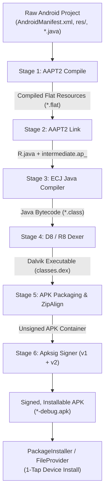

# Android On-Device APK Compiler 📱⚡

[](LICENSE)
[-green.svg)](https://developer.android.com)
[](https://developer.android.com/ndk/guides/abis)

A 100% self-contained, on-device Android compilation toolchain packaged as a modular Android library (`:compiler-engine`) and an interactive Jetpack Compose testbench demo app (`:app`).

Compile, DEX, package, sign, and install real Android APKs directly on physical Android phones — **zero PC, zero Docker, zero remote cloud server required**.

---

## 🏗️ Architecture & 5-Stage Pipeline

The engine executes the full native Android build toolchain directly within the mobile application sandbox:



### Toolchain Components Under the Hood:
1. **AAPT2 (Android Asset Packaging Tool 2):** Native statically-linked ARM64 binary executing directly via Android process fork, linking against bundled `android.jar` (API 35).
2. **ECJ (Eclipse Compiler for Java):** Pure JVM compiler running in-process to transform Java source files and generated `R.java` into `.class` bytecode.
3. **D8 (Android Dexer):** Google's high-performance DEX compiler producing `classes.dex`.
4. **ApkSigner & ZipAlign:** Cryptographic signing supporting APK Signature Scheme v1, v2, and v3 using embedded debug keystores.

---

## 📦 Project Structure

```text
android-apk-compiler/
├── compiler-engine/             # Reusable Android Library (AAR)
│   ├── src/main/
│   │   ├── java/com/yashwant/compiler/
│   │   │   ├── ApkCompilerEngine.kt        # 5-stage compilation engine orchestrator
│   │   │   ├── CompilerBootstrapManager.kt # Toolchain asset extractor & binary locator
│   │   │   ├── CompilerErrorParser.kt      # Diagnostic regex parser for ECJ & AAPT2 errors
│   │   │   ├── CompilerModels.kt           # Data classes and stage enums
│   │   │   └── ApkInstallerHelper.kt       # System PackageInstaller & FileProvider helper
│   │   ├── jniLibs/arm64-v8a/libaapt2.so   # Statically linked ARM64 AAPT2 executable
│   │   └── assets/compiler/
│   │       ├── android.jar                 # Android Platform API 35 stubs (26MB)
│   │       └── debug.keystore              # Standard Android debug keystore
│   └── src/test/                           # Automated compilation pipeline tests
│
└── app/                                # Interactive Testbench Demo App (Jetpack Compose)
    └── src/main/java/com/yashwant/compiler/demo/
        ├── MainActivity.kt                 # Compose Activity host
        ├── DemoCompilerViewModel.kt        # State manager & preset project scaffolder
        └── DemoCompilerScreen.kt           # Pipeline visualizer, progress stepper & install card
```

---

## 🚀 Quickstart: Using the Library in Your App

### 1. Add Library Dependency

In your app's `build.gradle.kts`:

```kotlin
dependencies {
    implementation(project(":compiler-engine")) // or use compiled AAR
}
```

### 2. Compile an Android Project On-Device

```kotlin
import com.yashwant.compiler.*
import java.io.File

// 1. Initialize Bootstrap Manager
val bootstrapManager = CompilerBootstrapManager(
    baseDir = context.filesDir,
    nativeLibDir = File(context.applicationInfo.nativeLibraryDir)
)

// 2. Extract bundled compiler assets
bootstrapManager.extractCompilerAssets { assetPath ->
    context.assets.open(assetPath)
}

// 3. Run Compilation
val engine = ApkCompilerEngine(bootstrapManager)
val projectDir = File(context.filesDir, "my_project")

val result: CompilerResult = engine.compileProject(projectDir) { progress ->
    println("[${progress.stage}] ${progress.progressPercent}% - ${progress.message}")
}

if (result.success && result.apkFile != null) {
    println("APK ready: ${result.apkFile.absolutePath} (${result.sizeBytes} bytes)")
    
    // 4. Trigger 1-Tap Installation
    ApkInstallerHelper.installApk(context, result.apkFile)
} else {
    System.err.println("Compilation failed at stage ${result.failedStage}: ${result.errorMessage}")
}
```

---

## 🛠️ Building the Project

### Prerequisites
- Android Studio Ladybug / Meerkat or Command Line Tools
- Android SDK Platform 35
- JDK 17+

### Run Automated Unit Tests
```bash
./gradlew :compiler-engine:testDebugUnitTest
```

### Build Testbench Demo APK
```bash
./gradlew :app:assembleDebug
```
The output APK will be generated at:
`app/build/outputs/apk/debug/app-debug.apk`

---

## 📄 License

Licensed under the **Apache License, Version 2.0** (the "License"). You may obtain a copy of the License at [LICENSE](LICENSE).

Copyright (c) 2026 Yashwant K ([@Yashwant00CR7](https://github.com/Yashwant00CR7)).
